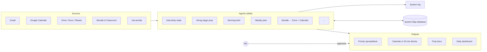

# Personal OS with Claude

**English** · [Português](README.pt-BR.md)

> How an engineering student juggling classes, a university extension project and 12+ internship hiring processes started coordinating everything with AI agents, while keeping every decision in her own hands.

---

## 1. The problem

In October 2026 I was handling, at the same time:

- engineering classes at Poli-USP, with materials scattered across Moodle, Google Classroom and email;
- 12+ internship hiring processes, each on a different portal (Gupy, Cia de Talentos, Kolab, JobConvo…), with its own stages and deadlines;
- an extension project, routines and personal commitments.

The bottleneck wasn't doing each task. It was **coordination**: knowing what's due first, where each file lives, what to prioritize, and not letting things fall between systems. I also wanted support for executive functions (planning, starting, staying focused) without relying on willpower alone.

## 2. The solution

A set of **specialized agents (Claude skills)** that read the same sources, write each piece of information in exactly one place, and hand me **proposals to approve**.

More in [docs/architecture.md](docs/architecture.md).

### Scheduled routines

| Agent | Runs | Delivers |
|---|---|---|
| Morning brief | Mon–Fri, 6 am | Daily dashboard: calendar, emails that need action, deadlines, suggested focus blocks |
| Weekly plan | Sunday, 6 pm | Calendar triage and a 2-week proposal for me to approve |
| Internship radar | Sunday & Wednesday (I trigger it) | Portal sweep, spreadsheet update, priority queue |

## 3. Design principles

1. **One fact, one place.** Every piece of data has an owner (a sheet, a doc, the calendar). Agents read the source instead of copying each other's rules.
2. **Human in the loop.** Suggestions land on a separate calendar and only become commitments after I approve. No agent sends email, applies to a job or deletes a file on its own.
3. **Explicit limits.** At most 3 new applications per week and up to 2 hours of career work per weekday, so the tool doesn't become the overload.
4. **25-minute focus blocks.** One focus per block, with the first step written in the event description.
5. **Security.** Agents never type passwords; expired login or captcha = skip and report.
6. **Versioned and logged.** Every skill carries a version and changelog. Every change is recorded in the system log and in the **System Map**, a database of the system's parts and how they connect.

Selected principles out of 45: [docs/principles.md](docs/principles.md). Dated decisions with context: [docs/decisions/](docs/decisions/).

## 4. Agent catalog (selection)

| Area | Skill | What it does |
|---|---|---|
| Career | `radar-estagios` | Sweeps portals and Gmail, updates the sheet, computes a 0–100 priority score and proposes the week's blocks. [See →](skills/radar-estagios/) |
| Career | `preparar-processo-seletivo` | For each hiring stage (test, case, panel, interview): researches company, market and people, builds a block-by-block plan, logs lessons afterwards. [See →](skills/preparar-processo-seletivo/) |
| Routine | `resumo-da-manha` | Daily dashboard + short message. [See →](skills/resumo-da-manha/) |
| Routine | `proposta-da-semana` | Weekly triage and 2-week proposal. [See →](skills/proposta-da-semana/) |
| Routine | `marcar-compromisso` | Calendar event in the right calendar, with color, address, commute and a ready-to-send message. |
| Routine | `triagem-tarefas` | Sorts tasks into do, schedule, delegate or delete. |
| Routine | `triagem-email` | Labels and senders, integrated with a Google Apps Script. |
| University | `moodle-upload` | Downloads course materials, files them and puts deadlines and exams on the calendar. |
| University | `plano-de-estudo-prova` | Exam study plan from past exams (topic frequency), with a focus page and timer. |
| University | `modo-aula` | Quick help during class. |
| Organization | `nomear-e-arquivar` | File naming and folder standard (Johnny Decimal) with duplicate prevention. [See →](skills/nomear-e-arquivar/) |
| Organization | `faxina-arquivos` | Quick and deep file clean-ups, always proposing first. [See →](skills/faxina-arquivos/) |
| Organization | `encerrar-chat` | Closes each conversation by logging decisions to the log and the Map. [See →](skills/encerrar-chat/) |
| Communication | `escrever-no-meu-estilo` | Drafts messages in my voice from a writing profile. |

## 5. Results (Oct 2026)

Counted on Oct 29, 2026, from the System Map and execution logs.

| What | Count |
|---|---|
| Active custom skills | 16 |
| Active scheduled tasks | 2 |
| Parts registered in the System Map | 275 |
| Changes logged in the Map (Oct 5–27) | 252 |
| Improvement proposals, each with a mini-PRD (why, done-when, reversible, risk) | 101 |
| Dated design principles | 45 |
| Emails archived on the Gmail script's first run (never sends, forwards or deletes) | 273 |
| Moodle files renamed to the standard | 163 |
| Versions of the Moodle collection skill | 13 |
| Hiring processes ranked on the radar's first run | 12 |

Timeline: AI-assisted Drive organization since Sep 2026 · system log since Oct 5, 2026 · Map with database since Oct 21, 2026.

## 6. What I learned

- **Good agents have small scopes.** Each skill owns one responsibility and reads the others as sources instead of copying their rules.
- **Data needs an owner.** Only one agent writes to each place (the radar writes the sheet; the morning brief only reads it). No duplicate versions of the truth.
- **Automation can overload too.** The sheet holds the backlog; the calendar shows little. Limits protect time, not just organize it.

## 7. What's in this repo

| Folder | What it is |
|---|---|
| [`docs/case-study.md`](docs/case-study.md) | The full case: problem, design, a day and a week, governance, results, lessons, next steps |
| [`skills/`](skills/) | 7 skills (public versions), each opening with what it shows |
| [`apps-script/`](apps-script/) | 4 Google Apps Script modules: calendar watcher, Drive tree, Gmail module, personal app v0.2 |
| [`templates/`](templates/) | System Map schema, log-line format, file and folder naming |
| [`docs/`](docs/) | Architecture, principles, decisions, tool lessons |

## 8. Privacy

This is a **showcase**, not a copy of the real system. See [PRIVACY.md](PRIVACY.md).

---

Built by [Gabriela Dória](https://github.com/gabrielavsdoria) · Environmental Engineering, Poli-USP · code under [MIT](LICENSE) · text under [CC BY 4.0](https://creativecommons.org/licenses/by/4.0/)
