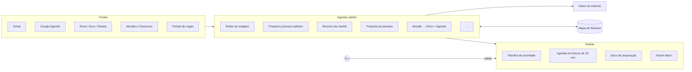

# Personal OS com Claude

[English](README.md) · **Português**

> Como uma estudante de engenharia com faculdade, extensão e mais de 12 processos seletivos ao mesmo tempo passou a coordenar tudo com agentes de IA, sem perder o controle das decisões.

---

## 1. O problema

Em out/2026 eu tinha, ao mesmo tempo:

- disciplinas da Poli com materiais espalhados entre Moodle, Classroom e e-mail;
- mais de 12 processos seletivos de estágio, cada um num portal (Gupy, Cia de Talentos, Kolab, JobConvo…), com etapas e prazos próprios;
- projeto de extensão, rotina e compromissos pessoais.

O gargalo não era fazer cada tarefa. Era **coordenar**: saber o que vence primeiro, onde está cada arquivo, o que priorizar e não deixar nada cair entre um sistema e outro. Somado a isso, eu queria apoio para as funções executivas (planejar, começar, manter o foco) sem depender só de força de vontade.

## 2. A solução

Um conjunto de **agentes especializados (skills do Claude)** que leem as mesmas fontes, escrevem cada informação num lugar só e me entregam **propostas para validar**.

Detalhes em [docs/architecture.md](docs/architecture.md).

### Rotinas agendadas

| Agente | Quando roda | O que entrega |
|---|---|---|
| Resumo da manhã | seg a sex, 6h | Painel do dia: agenda, e-mails que pedem ação, prazos, blocos de foco sugeridos |
| Proposta da semana | domingo, 18h | Triagem da agenda e proposta das próximas 2 semanas para eu validar |
| Radar de estágios | domingo e quarta (eu disparo) | Varredura dos portais, atualização da planilha e fila de prioridade |

## 3. Princípios de desenho

1. **Uma informação, um lugar.** Cada dado tem um dono (uma planilha, um doc, a agenda). Os agentes leem a fonte, não copiam regras entre si.
2. **Humano no loop.** Sugestões nascem numa agenda separada e só viram compromisso depois do meu ok. Nenhum agente envia e-mail, se inscreve em vaga ou apaga arquivo sozinho.
3. **Limites explícitos.** No máximo 3 inscrições novas por semana e até 2h de carreira por dia útil, para a ferramenta não virar sobrecarga.
4. **Foco em blocos de 25 min.** Um foco por bloco, com o primeiro passo escrito na descrição do evento.
5. **Segurança.** Agentes nunca digitam senha; login caído ou captcha = pular e avisar.
6. **Versionado e registrado.** Cada skill tem versão e changelog no cabeçalho. Toda mudança fica no Diário e no **Mapa do Sistema**, um banco de dados com as peças do sistema e como se ligam.

Os 45 princípios do sistema (seleção): [docs/principles.md](docs/principles.md). Decisões com data e contexto: [docs/decisions/](docs/decisions/).

## 4. Catálogo de agentes (seleção)

| Área | Skill | O que faz |
|---|---|---|
| Carreira | `radar-estagios` | Varre portais e Gmail, atualiza a planilha, calcula a nota de prioridade e propõe os blocos da semana. [Ver →](skills/radar-estagios/) |
| Carreira | `preparar-processo-seletivo` | Para cada etapa (teste, case, painel, entrevista): pesquisa empresa, mercado e pessoas, monta o plano em blocos e registra o aprendizado depois. [Ver →](skills/preparar-processo-seletivo/) |
| Rotina | `resumo-da-manha` | Painel diário + mensagem curta. [Ver →](skills/resumo-da-manha/) |
| Rotina | `proposta-da-semana` | Triagem e proposta de 2 semanas. [Ver →](skills/proposta-da-semana/) |
| Rotina | `marcar-compromisso` | Evento na agenda certa, com cor, endereço, deslocamento e mensagem pronta. |
| Rotina | `triagem-tarefas` | Classifica tarefas em fazer, agendar, delegar ou apagar. |
| Rotina | `triagem-email` | Rótulos e remetentes, integrada a um script em Google Apps Script. |
| Faculdade | `moodle-upload` | Baixa materiais do Moodle, organiza no drive e põe prazos e provas na agenda. |
| Faculdade | `plano-de-estudo-prova` | Plano de estudo a partir de provas antigas (frequência de temas), com página de foco e timer. |
| Faculdade | `modo-aula` | Ajuda rápida durante a aula. |
| Organização | `nomear-e-arquivar` | Padrão de nomes e pastas (Johnny Decimal) e anti-duplicata. [Ver →](skills/nomear-e-arquivar/) |
| Organização | `faxina-arquivos` | Faxina rápida e profunda de arquivos, sempre com proposta antes. [Ver →](skills/faxina-arquivos/) |
| Organização | `encerrar-chat` | Fecha cada conversa registrando decisões no Diário e no Mapa. [Ver →](skills/encerrar-chat/) |
| Comunicação | `escrever-no-meu-estilo` | Rascunha mensagens no meu estilo a partir de um perfil de escrita. |

## 5. Resultados (out/2026)

Números contados em 29/10/2026, a partir do Mapa do Sistema e dos registros de execução.

| O quê | Número |
|---|---|
| Skills próprias ativas | 16 |
| Tarefas agendadas ativas | 2 |
| Peças registradas no Mapa do Sistema | 275 |
| Mudanças registradas no log do Mapa (05/10 a 27/10) | 252 |
| Propostas de melhoria, cada uma com mini-PRD (porquê, pronto quando, reversível, risco) | 101 |
| Princípios de desenho com data | 45 |
| E-mails arquivados na 1ª rodada do script de Gmail (sem enviar, encaminhar ou apagar nada) | 273 |
| Arquivos do Moodle renomeados para o padrão | 163 |
| Versões da skill de coleta do Moodle | 13 |
| Processos seletivos priorizados na 1ª rodada do radar | 12 |

Linha do tempo: organização do Drive com IA desde set/2026 · registro do sistema desde 05/10/2026 · Mapa com banco de dados desde 21/10/2026.

## 6. O que aprendi

- **Agente bom tem escopo pequeno.** Cada skill tem uma responsabilidade e lê as outras como fonte, em vez de copiar as regras delas. Mudar uma regra não exige mexer em cinco lugares.
- **O dado precisa de dono.** Só um agente escreve em cada lugar (o radar escreve na planilha; o resumo da manhã só lê). Isso evita duas versões da mesma informação.
- **Automação também sobrecarrega.** A planilha segura o backlog e a agenda mostra pouco. Os limites protegem o tempo, não só organizam.

## 7. O que tem neste repositório

| Pasta | O que é |
|---|---|
| [`docs/case-study.pt-BR.md`](docs/case-study.pt-BR.md) | O caso completo: problema, desenho, um dia e uma semana, governança, resultados, aprendizados, próximos passos |
| [`skills/`](skills/) | 7 skills (versões públicas), cada uma abrindo com o que ela mostra |
| [`apps-script/`](apps-script/) | 4 módulos em Google Apps Script: vigia de agenda, árvore do Drive, módulo do Gmail, app pessoal v0.2 |
| [`templates/`](templates/) | Esquema do Mapa do Sistema, formato da linha do Diário, nomes de arquivos e pastas |
| [`docs/`](docs/) | Arquitetura, princípios, decisões, aprendizados sobre as ferramentas |

## 8. Privacidade

Esta é uma **vitrine**, não uma cópia do sistema real. Veja [PRIVACY.md](PRIVACY.md).

---

Feito por [Gabriela Dória](https://github.com/gabrielavsdoria) · Engenharia Ambiental, Poli-USP · Código sob licença [MIT](LICENSE) · textos sob [CC BY 4.0](https://creativecommons.org/licenses/by/4.0/deed.pt_BR)
