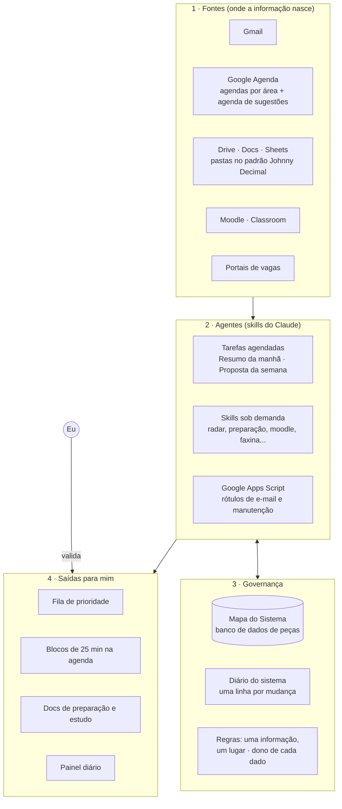
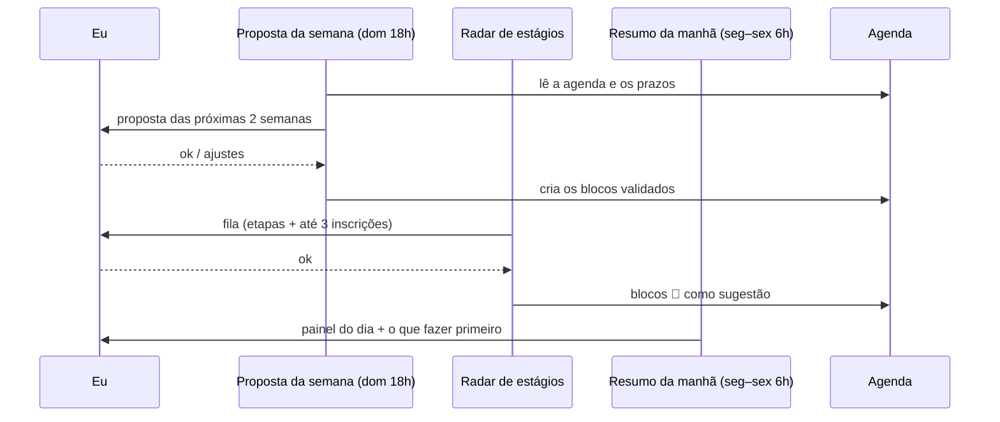

# Arquitetura · Architecture

## Camadas

## Fluxo de uma semana típica

## Quem escreve onde

| Lugar | Quem escreve | Quem só lê |
|---|---|---|
| Planilha de prioridade de estágios | `radar-estagios` | `resumo-da-manha`, `proposta-da-semana` |
| Docs de preparação de etapa | `preparar-processo-seletivo` | `radar-estagios` |
| Agenda de sugestões | qualquer agente | — |
| Agendas por área | só depois do meu ok | todos |
| Mapa do Sistema e Diário | `encerrar-chat` | todos |
