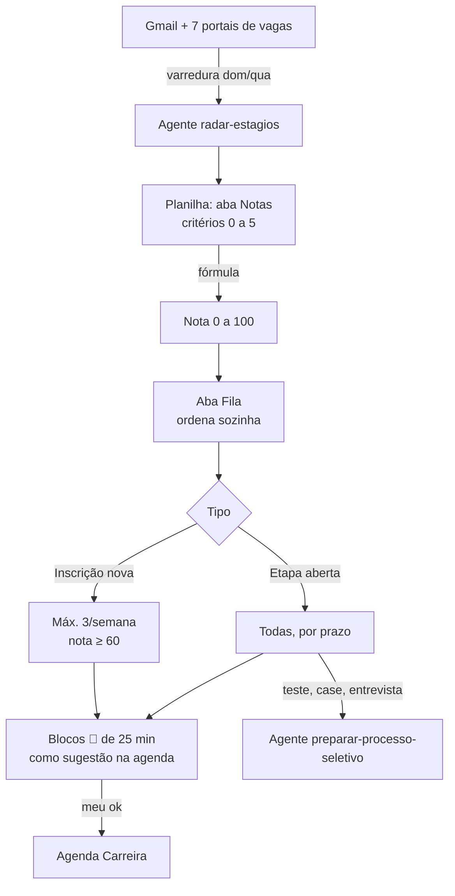

# Radar de estágios

Agente que transforma uma busca de estágio caótica (vários portais, e-mails, prazos) numa **fila de prioridade** e numa **agenda realista**.

## Problema

Mais de 12 processos seletivos ao mesmo tempo, cada um num portal. Sem critério, a tendência é aplicar para tudo e se preparar mal para o que importa.

## Como funciona



1. **Coleta:** lê o Gmail e abre cada portal no navegador (sem nunca digitar senha).
2. **Nota:** 9 critérios com pesos que eu defini (fit de longo prazo, aprendizado, chance, efetivação, prestígio, bolsa, esforço, local, início). Dado desconhecido vale 3 e fica marcado "a confirmar".
3. **Fila:** etapas abertas primeiro, pelo prazo; inscrições novas limitadas a 3 por semana.
4. **Agenda:** propõe blocos de 25 min numa agenda de sugestões; só viram compromisso depois do meu ok.
5. **Aprendizado:** depois de cada etapa, outro agente registra o que aprendi num banco de histórias STAR.

## Arquivos

| Arquivo | O que é |
|---|---|
| [`SKILL.md`](SKILL.md) | As instruções do agente (versão pública da v5, sem dados pessoais). |
| [`score.py`](score.py) | O modelo de nota e a regra da fila em Python, para quem quiser reproduzir sem a planilha. |
| [`exemplo_vagas.csv`](exemplo_vagas.csv) | Dados fictícios para testar. |

```bash
python score.py exemplo_vagas.csv
```

```
ETAPAS ABERTAS (todas, por prazo)
   89.6  Empresa A (bens de consumo)  03/11
   76.8  Empresa B (energia)          06/11
   42.4  Empresa C (logística)        sem prazo

INSCRIÇÕES DESTA SEMANA (máx. 3, nota ≥ 60)
   74.8  Empresa D (consultoria)      10/11
   70.8  Empresa F (tecnologia)       12/11  (a confirmar: local)
   68.8  Empresa E (varejo)           17/11  (a confirmar: bolsa_beneficios)

BACKLOG (passa na nota, fica para a próxima semana)
   64.4  Empresa G (mineração)        20/11

FORA (nota < 60)
   51.4  Empresa H (startup)          08/11
```

## Evolução

| Versão | O que mudou |
|---|---|
| set/2026 | Matriz de decisão manual num doc. |
| v2 (22/10/2026) | Vira agente: radar de vagas e prazos ligado à agenda. |
| v5 (25/10/2026) | Nota ponderada de 0 a 100, fila automática na planilha, varredura semanal dos portais, limite semanal, blocos de 25 min e integração com o agente de preparação de etapas. |

## Decisões de desenho

- **Prazo não entra na nota.** Urgência e importância são coisas diferentes: o prazo só ordena a fila.
- **Limite de 3 inscrições por semana.** Força escolher, em vez de espalhar esforço.
- **Nota abaixo de 40 numa etapa aberta = sugerir desistir.** Sair de um processo também é decisão.
- **O agente prepara, não aplica.** Inscrição, envio e testes são sempre meus.
